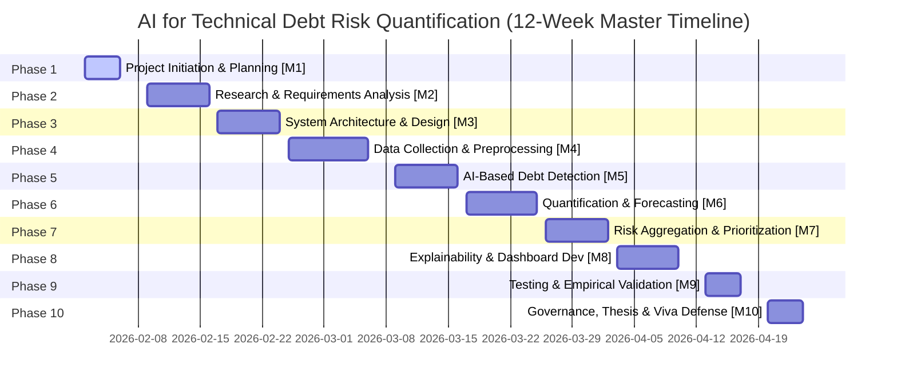

# AI for Technical Debt Risk Quantification: Microsoft Project Management Model
## A Multi-Source, Forecast-Aware Framework for Evidence-Based Prioritization

**Academic Course:** Software Management & Engineering Laboratory  
**Target Program:** Computer Science and Engineering  
**Project Baseline:** 12 Weeks (60 Working Days: Monday, February 2, 2026 – Friday, April 24, 2026)  
**Standard Calendar:** 5 working days/week (Monday–Friday, 8:00 AM – 5:00 PM with 1-hr lunch = 8 hours/day). Weekends non-working.  

---

## 1. Project Directory & Generated Deliverables

This repository contains the complete, professionally calibrated Microsoft Project management package:

| File Name | Format | Purpose & Description |
|---|---|---|
| **`AI_Technical_Debt_Model.xml`** | MS Project XML | **Primary Standard Model.** Full Microsoft Project XML Schema-compliant file. Opens directly in MS Project (2016, 2019, 2021, and Microsoft 365) preserving complete WBS hierarchy, Gantt chart, task links, calendars, milestones, and resource assignments. |
| **`AI_Technical_Debt_Project_Workbook.xlsx`** | Excel Workbook | **Multi-Tab Executive Model.** 6 formatted tabs: *Project Dashboard, Master WBS & Schedule, Resource Allocation, Milestones & Deliverables, Cost Management, and Demonstration Guide*. |
| **`MS_Project_Task_Import.csv`** | CSV Data File | Clean tabular task data formatted specifically for the Microsoft Project Import Wizard. |
| **`generate_ms_project_model.py`** | Python Automation | Fully documented Python generator and validation script with scheduling engine and schema verification. |
| **`README.md`** | Markdown Documentation | Comprehensive academic documentation, WBS explanation, and viva presentation guide. |

---

## 2. Research Paper Alignment & Architectural Dimensions

The schedule models the empirical research lifecycle for technical debt quantification, strictly capturing the **four analytical dimensions** and **multi-source ingestion pipelines** articulated in the research paper:

```
+----------------------------------------------------------------------------------------------------+
|                                    MULTI-SOURCE EVIDENCE INGESTION                                  |
|  [Git Repos & ASTs] [SonarQube Metrics] [Commit Churn Logs] [Jira/SATD Comments] [CVE/Outage Logs] |
+-------------------------------------------------+--------------------------------------------------+
                                                  |
                                                  v
+----------------------------------------------------------------------------------------------------+
|                                      FOUR ANALYTICAL DIMENSIONS                                     |
|  1. Debt Confidence (Cd)  : Posterior probability P(genuine debt | evidence) calibrated via Brier  |
|  2. Debt Principal (Pd)   : One-time refactoring effort in person-hours proxy                      |
|  3. Debt Interest (Id(H)) : Time-series friction & bug drag forecasted across H in {30,90,180} days |
|  4. Adverse-Event (Radv)  : Outage & security vulnerability risk curves P(event) x Severity         |
+-------------------------------------------------+--------------------------------------------------+
                                                  |
                                                  v
+----------------------------------------------------------------------------------------------------+
|                                 RISK AGGREGATION & DECISION ENGINE                                  |
|  - Remediation Effectiveness (epsilon)      - Component Topological Centrality (PageRank)          |
|  - Business Asset Criticality Multipliers   - Engineering Capacity Knapsack Constraints             |
+-------------------------------------------------+--------------------------------------------------+
                                                  |
                                                  v
+----------------------------------------------------------------------------------------------------+
|                                   EXPLAINABLE HUMAN-IN-THE-LOOP UI                                  |
|  [Interactive Dashboard] [Multi-Horizon Sliders] [SHAP Feature Attribution] [Manual Override Logs]  |
+----------------------------------------------------------------------------------------------------+
```

---

## 3. Work Breakdown Structure (WBS) & 10 Major Phases

The project plan structures **10 major phases**, **84 detailed work packages**, and **10 control milestones** across exactly **60 working days**:



### Summary of Phases:
1. **Phase 1: Project Initiation and Planning (WBS 1.0, 5 days: Feb 2 – Feb 6)**  
   Problem framing, research objectives, lab boundaries, academic assumptions, collaboration environment setup, schedule baseline, and Charter sign-off (**Milestone 1 / Deliverable D1**).
2. **Phase 2: Research and Requirement Analysis (WBS 2.0, 6 days: Feb 9 – Feb 16)**  
   Literature review on SQALE/SATD, machine learning debt detection papers, refactoring effort estimation, interest dynamics, IEEE 830-compliant SRS baselining (**Milestone 2 / Deliverables D2, D3**).
3. **Phase 3: System Architecture and Design (WBS 3.0, 6 days: Feb 17 – Feb 24)**  
   Modular framework architecture, multi-source ingestion adapters, technical debt taxonomy schema, 4-dimension prediction pipeline, and architecture review (**Milestone 3 / Deliverable D4**).
4. **Phase 4: Data Collection and Preprocessing (WBS 4.0, 8 days: Feb 25 – Mar 6)**  
   Mining Git repositories, AST extraction, SonarQube violation parsing, commit churn, Jira/SATD text harvesting, CVE records, stratified data partitioning, and provenance validation (**Milestone 4 / Deliverable D5**).
5. **Phase 5: AI-Based Technical-Debt Detection (WBS 5.0, 6 days: Mar 9 – Mar 16)**  
   Multi-modal feature vector assembly, heuristic rule baseline, model training (XGBoost/LightGBM), probability calibration via Isotonic regression for valid $C_d$, and qualitative sample audits (**Milestone 5 / Deliverable D6**).
6. **Phase 6: Technical-Debt Quantification and Forecasting (WBS 6.0, 7 days: Mar 17 – Mar 25)**  
   Debt Principal ($P_d$) regression, multi-horizon interest forecasting ($I_d(H)$ for $H \in \{30, 90, 180\}$ days), adverse-event probability modeling ($P_{event}$), remediation effectiveness ($\epsilon$), and uncertainty bounds (**Milestone 6 / Deliverable D7**).
7. **Phase 7: Risk Aggregation and Prioritization (WBS 7.0, 6 days: Mar 26 – Apr 2)**  
   Integrating $C_d$, $P_d$, $I_d(H)$, and $R_{adv}$, factoring in component dependency graphs (PageRank centrality), 0-1 knapsack capacity constraints, and Pareto ranking (**Milestone 7 / Deliverable D8**).
8. **Phase 8: Explainability and Dashboard Development (WBS 8.0, 6 days: Apr 3 – Apr 10)**  
   Interactive UI implementation: Debt Overview, multi-horizon forecast visualizers, dependency graphs, SHAP feature attributions, knapsack capacity slider, and human-in-the-loop manual override logger (**Milestone 8 / Deliverable D9**).
9. **Phase 9: Testing and Validation (WBS 9.0, 5 days: Apr 13 – Apr 17)**  
   End-to-end integration tests, model calibration evaluation (Brier score & reliability curves), error analysis (MAE/RMSE), benchmark comparisons against naive policies, sensitivity analysis, and academic threats to validity (**Milestone 9 / Deliverable D10**).
10. **Phase 10: Governance, Documentation, and Final Delivery (WBS 10.0, 5 days: Apr 20 – Apr 24)**  
    Model governance protocols, data sheets, model cards, final IEEE research paper, reproducible Docker container, slide deck, mock rehearsal, and viva defense (**Milestone 10 / Deliverables D11, D12**).

---

## 4. Milestone Gateway & Deliverable Mapping

Every project deliverable maps directly to an explicit zero-duration control milestone signed off by the Faculty Supervisor:

| Milestone | Date | Linked Deliverable | Formal Deliverable Title & Acceptance Criteria |
|---|---|---|---|
| **M1 (Task 10)** | 2026-02-06 | **D1** | **Project Charter & Management Plan:** Problem definition, research scope, 12-week schedule baseline, and academic team roles. |
| **M2 (Task 22)** | 2026-02-16 | **D2, D3** | **Software Requirements Specification & Literature Review:** IEEE 830 SRS with functional requirements for multi-source ingestion, NFRs for uncertainty and latency. |
| **M3 (Task 35)** | 2026-02-24 | **D4** | **System Architecture Document:** Modular service boundaries, multi-source ingestion adapter specs, and 4-dimension prediction pipeline. |
| **M4 (Task 50)** | 2026-03-06 | **D5** | **Preprocessed Multi-Source Dataset:** Curated code, commit, issue, and AST dataset with provenance documentation and stratified splits. |
| **M5 (Task 62)** | 2026-03-16 | **D6** | **AI Debt Detection Engine:** Validated classification pipeline outputting calibrated Debt Confidence probabilities ($C_d$) with Brier score $< 0.15$. |
| **M6 (Task 75)** | 2026-03-25 | **D7** | **Quantification & Forecasting Engine:** Principal regression ($P_d$) and multi-horizon interest forecasting ($I_d(H)$) models with uncertainty bounds. |
| **M7 (Task 87)** | 2026-04-02 | **D8** | **Risk Prioritization Module:** Multi-criteria optimization engine integrating adverse-event risk, component centrality, and knapsack capacity constraints. |
| **M8 (Task 100)** | 2026-04-10 | **D9** | **Explainable Risk Dashboard Prototype:** Interactive dashboard featuring 4 dimensions, ripple-effect graph, and human-in-the-loop override log. |
| **M9 (Task 115)** | 2026-04-17 | **D10** | **Testing & Validation Technical Report:** End-to-end verification report, calibration curves, error metrics (MAE/RMSE), and threats to validity. |
| **M10 (Task 128)** | 2026-04-24 | **D11, D12** | **Final Research Report & Viva Defense Package:** Comprehensive IEEE-format academic paper, reproducible Docker container, slide deck, and oral viva defense. |

---

## 5. Resource Allocation & Academic Roles

In an academic laboratory environment, students may wear multiple hats; however, to maintain industrial project-management rigor and avoid artificial resource contention, roles are partitioned cleanly:

| Resource ID | Resource Name | Role Classification | Units | Assigned Tasks | Responsibilities |
|---|---|---|---|---|---|
| **RES-01** | Student Lead / PM | Project Manager & Architect | 100% | 22 tasks | Scope baseline, governance, charter, risk policy, oral defense |
| **RES-02** | Software Developer | Full-Stack & Systems Dev | 100% | 26 tasks | Ingestion pipeline, AST extractors, REST APIs, dashboard backend |
| **RES-03** | AI/ML Developer | Machine Learning Engineer | 100% | 34 tasks | Detection models, confidence calibration, regression, uncertainty |
| **RES-04** | Data Analyst | Repository Mining Specialist | 100% | 23 tasks | Git churn mining, SonarQube parsing, SATD curation, cleaning |
| **RES-05** | UI/UX Designer | Front-End & Visualization | 100% | 14 tasks | Wireframes, forecast visualizer, dependency graph, override UI |
| **RES-06** | Software Tester | QA & Empirical Verification | 100% | 16 tasks | Automated testing, calibration checks, MAE/RMSE, ablation studies |
| **RES-07** | Research Lead | Academic Documentation Lead | 100% | 25 tasks | Literature survey, SRS, empirical report, threats to validity |
| **RES-08** | Faculty Supervisor | Academic Advisor & Examiner | 20% | 14 tasks | Milestone sign-offs, architecture reviews, viva evaluation |
| **RES-09** | GPU / Cloud Compute | Compute Infrastructure | Cost | - | Model training & cross-validation (Illustrative $60.00 credit) |
| **RES-10** | Dev Tools & Licenses | Tooling & Repositories | Cost | - | Static analysis, IDEs, and GitHub Classroom hosting ($0.00 academic) |

---

## 6. How to Open and View in Microsoft Project

### Method 1: Direct XML Open (Recommended)
1. Launch **Microsoft Project**.
2. Click **File > Open > Browse**.
3. In the file type dropdown at the bottom-right of the file dialog, change from `Project Files (*.mpp)` to **`XML Format (*.xml)`**.
4. Select **`AI_Technical_Debt_Model.xml`** and click **Open**.
5. When the import wizard appears:
   - Choose **As a new project**.
   - Click **Finish**.
6. The entire project plan will render instantly with the complete 10-phase outline, indented subtasks, duration bars, predecessor arrows, resource assignments, and milestone markers.

### Method 2: CSV Import Wizard
1. Launch **Microsoft Project**.
2. Click **File > Open > Browse**, and set file type dropdown to **`Text (Tab delimited) or CSV (Comma delimited)`**.
3. Select **`MS_Project_Task_Import.csv`**.
4. In the Import Wizard:
   - Select **New map**.
   - Select **Tasks** only.
   - Map `Task_Name` to `Name`, `Duration_Days` to `Duration`, `Start_Date` to `Start`, `Predecessors` to `Predecessors`, `Resource_Names` to `Resource Names`, and `Outline_Level` to `Outline Level`.
   - Click **Finish**.

---

## 7. How to Demonstrate Key Views to Faculty Examiners

When presenting this model during your Software Management Lab viva, follow this exact sequence:

### 1. Gantt Chart & WBS Hierarchy View
- **Action:** Go to **View > Gantt Chart**.
- **Demonstration:** Show examiners the 10 major summary phases (1.0 to 10.0) marked by black summary brackets. Expand Phase 5 and Phase 6 to demonstrate how the core research algorithms are scheduled. Show that milestones (e.g., M1, M2... M10) are highlighted with distinctive diamond shapes and zero days.

### 2. Highlighting the Critical Path
- **Action:** Go to the **Format** ribbon tab and check the **Critical Tasks** checkbox (or navigate to **View > Data > Highlight > Critical**).
- **Demonstration:** Explain to the examiner:
  > *"Professor, MS Project calculates the critical path based on zero total slack. Our critical path spans from Milestone 1 through Phases 2, 3, 4, 5, 6, 7, 8, 9, to Milestone 10. Any delay in model calibration or dataset curation directly delays the final viva defense because downstream multi-criteria prioritization strictly depends on calibrated probability bounds."*

### 3. Task Sheet & Traceability View
- **Action:** Go to **View > Task Sheet**, click **Table > Entry**.
- **Demonstration:** Point out the WBS numbering (1.1, 1.2... 10.12). Emphasize that predecessors use logical link types: standard Finish-to-Start (`FS`) for sequential dependencies and Start-to-Start with positive lag (`SS+1d`) for overlapping tasks (e.g., feature engineering running concurrently with AST mining).

### 4. Resource Sheet & Allocation Matrix
- **Action:** Go to **View > Resource Sheet**.
- **Demonstration:** Show all 8 human resources and 2 cost resources. Explain:
  > *"Notice that all resources are leveled at 100% max units (and Faculty Supervisor at 20%). By decomposing the project into distinct roles (PM, ML Developer, Data Analyst, Tester), we avoid unrealistic single-resource over-allocations while modeling genuine team software engineering."*

### 5. Setting and Inspecting the Project Baseline
- **Action:** Go to **Project > Set Baseline > Set Baseline for Entire Project**.
- **Demonstration:** Explain that this locks the original planned dates. To show tracking progress:
  - Select Task 2 (1.1 Define Problem), click **Task > 100% Complete**.
  - Show how the blue Gantt bar fills in with a solid progress stripe and the summary task automatically rolls up.

### 6. Tracking Gantt View
- **Action:** Go to **View > Task Views > Tracking Gantt**.
- **Demonstration:** Show examiners the dual-bar comparison: the bottom baseline bar (original schedule) versus the top actual progress bar. Point out that Schedule Variance (SV) and Cost Variance (CV) can be monitored at each milestone gate.

---

## 8. Academic Viva Defense Q&A Cheat Sheet

Prepare for these common examiner questions:

**Q1: Why is this schedule 12 weeks rather than a 6-month industrial release?**  
*Answer:* This project models an academic prototype development and empirical validation lifecycle within a university semester (60 working days). In accordance with academic honesty, it delivers a functional research prototype and evaluation benchmark on open-source repositories rather than claiming a commercial production deployment.

**Q2: How does the schedule reflect the 4 dimensions in the paper?**  
*Answer:* The schedule explicitly dedicates Phase 5 to **Debt Confidence ($C_d$)** calibration, Phase 6 to **Debt Principal ($P_d$)** estimation and **Multi-Horizon Interest Forecasting ($I_d(H)$)**, and Phase 7 to **Adverse-Event Risk ($R_{adv}$)** and knapsack capacity aggregation. Each dimension is isolated into verifiable work packages before being synthesized in Phase 8's explainable dashboard.

**Q3: Why calibrate debt confidence instead of using raw classifier accuracy?**  
*Answer:* Uncalibrated classifiers produce overconfident probabilities. For prioritization, if an issue has an estimated interest of 100 hours with raw confidence 0.99 but true calibrated probability 0.50, the risk-adjusted ROI would be severely distorted. Task 5.5 and Task 9.5 explicitly use Isotonic regression and Brier score verification to ensure probabilities are statistically meaningful.

**Q4: How does the model prevent resource overallocation?**  
*Answer:* Tasks within each phase are logically staggered using Finish-to-Start and Start-to-Start relationships with lags. Roles with heavy workloads (such as the AI/ML Developer and Data Analyst) hand off intermediate artifacts (e.g., preprocessed datasets at Task 4.14) before intensive training begins in Phase 5.
